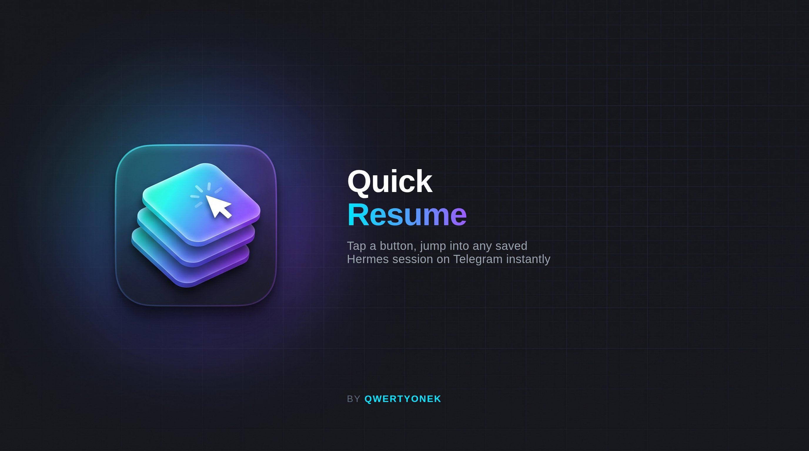

# Hermes Telegram Quick Resume



A tap-to-use menu for Hermes Agent's Telegram gateway. Stop typing `/resume 3`
— tap it instead.

## What it does

- **`/menu`** — a button dashboard: jump into a saved session, or browse
  every built-in slash command grouped into 7 categories (Sessions, Run
  control, Model & behavior, Status & usage, Automation, Skills &
  maintenance, System).
- **`/qr`** — straight to the tap-to-resume session list.
- Tap a category → see what's in it → tap "Show tappable commands" → a row
  of real buttons appears, one per command. Tap one and it sends.

## How it actually works (and why)

Telegram bots have two button systems:

- **Inline buttons** (`InlineKeyboardMarkup`) — attached to a specific
  message, trigger a `callback_query` your bot code handles in Python.
- **Reply keyboard buttons** (`ReplyKeyboardMarkup`) — shown above the
  text input, and tapping one **sends its label as a normal text message**,
  exactly as if the user typed it.

This plugin uses inline buttons only for *navigation* (open a category, go
back) — nothing executes from an inline tap. The commands themselves
(`/resume 3`, `/status`, `/model`, ...) are **reply-keyboard buttons**, so
tapping one sends that exact text as a genuine incoming Telegram message.
Hermes's own command dispatcher sees it, authorizes it, and runs it — the
same path as if you'd typed it by hand.

This is deliberate, not a workaround. Hermes's plugin API
(`ctx.inject_message`) forces every plugin-injected message to
`allow_gateway_control=False` (see `gateway/platforms/event.py`'s
`get_command()`), so a plugin can never make a slash command execute
programmatically — only hand conversational text to the LLM. That's a real
security boundary: a plugin must never drive the gateway's control plane
on a user's behalf without the user's own message hitting the wire. Reply
keyboards respect that boundary completely while still feeling like a
one-tap UI.

## Install

```bash
hermes plugins install qwertyonek/hermes-telegram-quick-resume
hermes plugins enable hermes-telegram-quick-resume
```

Restart the gateway (`hermes gateway restart`) and send `/menu` to your bot.
No config flags, no consent screens — every button just sends a plain
message, same as typing.

## Disclosure

- **No network calls.** Everything runs locally against your own Hermes
  gateway and Telegram bot connection.
- **No credentials read.** The plugin never touches `.env`, `auth.json`, or
  any token file — it only uses the public `ctx.register_telegram_handler`
  and `ctx.register_command` plugin APIs.
- **Reads your own session list** via the public `hermes sessions list`
  CLI, scoped to the `telegram` source, to build the resume buttons.
- **No background processes, no telemetry, no self-update, no plugin
  message injection.**

## How it works (for reviewers / contributors)

- `menu.py` — static data: command → category → button label. No framework
  imports, safe to edit without touching the plugin's registration logic.
- `sessions.py` — shells out to `hermes sessions list --source telegram`
  (the same CLI a user runs) and parses the table into button rows. Never
  reads `state.db` directly.
- `__init__.py` — `register(ctx)` wires:
  - `ctx.register_telegram_handler(factory)` → adds `/menu`, `/qr`
    `CommandHandler`s and a prefix-scoped `CallbackQueryHandler` (`qr:...`)
    to the live python-telegram-bot `Application`, so core's own button
    handlers are untouched.
  - `ctx.register_command("menu", ...)` → makes `/menu` discoverable outside
    Telegram too (CLI, other gateways), falling back to plain text there.
  - Every actual command send goes through `ReplyKeyboardMarkup` buttons
    whose label IS the command text — Hermes never sees a difference
    between that and the user typing it.

## License

MIT — see [LICENSE](LICENSE).
